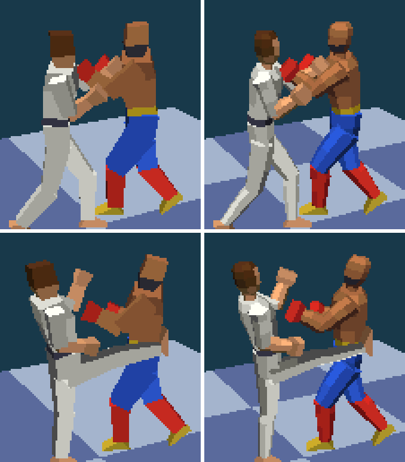
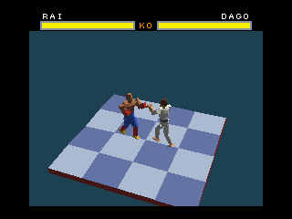
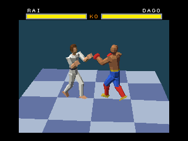
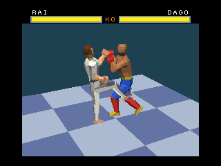
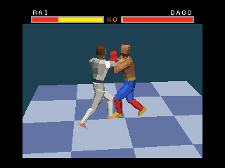
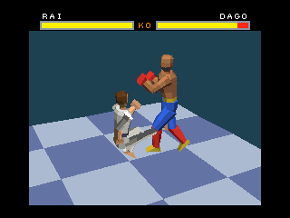
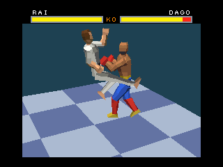
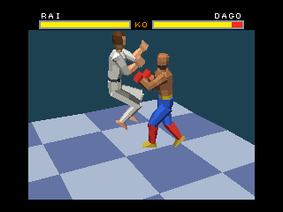
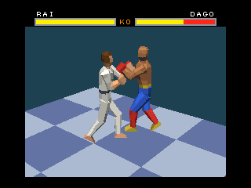

# GEO FIGHTER

Jogo de luta 3D para MSX com o V9968 e o coprocessador geo3d, no estilo do Virtua Fighter: lutadores de polígonos sombreados num ringue 3D. O plano é ter 6 personagens e 8 cenários.

Este repositório está na fase do **demo de teste**: dois personagens (RAI e DAGO) lutam num ringue visto em diagonal e de cima, depois de a câmera dar uma volta completa em torno dele.

**O jogo precisa do geo3d v2.0** (ramo `geo3d-v2.0` de V9968_Cartridge), que guarda até 1.023 vértices e faces: cada lutador tem 420 vértices e 386 faces, e a cena inteira 869 e 792. Com o geo3d v1.0.0 o cartucho mostra "GEO3D V2.0 NECESSARIO" e para. A versão para o geo3d v1.0.0, com 120 vértices por lutador, é a do commit `8afb1ac`.



*À esquerda os lutadores do geo3d v1.0.0 (120 vértices cada), à direita os do v2.0 (420), no mesmo quadro, ampliados.*

 

 

 

 

## O que o demo faz

- Título, giro de 360° da câmera em volta do ringue até fechar nos lutadores, "ROUND 1", "FIGHT!", luta, nocaute, pose de vitória, novo round.
- Jogador 1 no teclado ou no joystick 1 contra a máquina. Sem apertar nada no título, a máquina joga contra si mesma.
- Golpes: soco, chute, soco baixo, rasteira, voadora e soco de cima. Pulo, agachamento e passo lateral, que gira o eixo da luta dentro do ringue.
- Duas defesas, em pé e agachada: cada golpe tem uma altura, e a altura decide qual defesa o segura.
- 30 quadros por segundo, com som de golpe, defesa e queda no PSG.

## Controles

| Ação | Teclado | Joystick 1 |
|---|---|---|
| Andar | cursores esquerda e direita | esquerda e direita |
| Soco | ESPAÇO ou Z | botão A |
| Chute | X | botão B |
| Pulo | um toque no cursor para cima | para cima |
| Voadora | para cima com chute (juntos, ou o chute durante o pulo) | para cima com B |
| Soco de cima | para cima com soco (juntos, ou o soco durante o pulo) | para cima com A |
| Agachar e defender | segurar o cursor para baixo | para baixo |
| Rasteira | agachado, chute | para baixo com B |
| Soco baixo | agachado, soco | para baixo com A |
| Passo lateral para o fundo | dois toques rápidos para cima | dois toques para cima |
| Passo lateral para a frente | dois toques rápidos para baixo | dois toques para baixo |
| Defesa em pé | C, ou andar para trás na hora do golpe | para trás na hora do golpe |
| Voltar ao título | RETURN | |

No ar, esquerda e direita ainda levam o lutador para a frente ou para trás. O segundo toque do passo lateral tem de vir em até 0,3 s.

| Golpe | Altura | Quem segura |
|---|---|---|
| Soco | alto | defesa em pé; passa por cima de quem está agachado |
| Chute | médio | as duas defesas |
| Soco baixo, rasteira | baixo | só a defesa agachada; não pega quem está no ar |
| Voadora, soco de cima | de cima | só a defesa em pé |

O passo lateral tira o lutador da linha de qualquer golpe.

No demo automático, ESPAÇO ou o botão A passa o controle do RAI para você. Durante o giro de abertura, um novo toque em ESPAÇO ou no botão A pula direto para a luta.

## Como rodar

- **openMSX (fork com V9968 e geo3d, ramo `geo3d-v2.0`):** `jogar_openmsx.bat`, que usa o `openmsx_geo3d_v2.exe` de `..\openmsx-geo3d`, ou
  `openmsx -machine C-BIOS_V9968_JP -ext geo3d -cart release/GEOFIGHTER_98.ROM -romtype ASCII16`.
- **blueMSX+ (ramo local `geo3d-v2.0`):** `bluemsx_geo3d_v2.bat` em `..\blueMSX-plus-builds` abre o jogo na máquina `MSX2+ - C-BIOS V9968`.
- **Cartucho real (V9968 em 88h):** `release/GEOFIGHTER_88.ROM`, MegaROM ASCII16 de 256 KB, com o bitstream do geo3d v2.0 (`geo3d_v2.0-dev_1023.fs`; o firmware oficial do HRA! é o v1.0.0).
- **Raspberry Pi com o pacote geo3d-rpi:** o pacote ainda traz o openMSX do geo3d v1.0.0; o jogo atual não roda nele.

## Como montar

No WSL ou em Linux, com `z80asm` 1.8 e `python3` (sem pacotes extras):

```sh
bash build.sh          # gera out/ e copia as ROMs para release/
bash build.sh --data   # refaz também modelos, poses e tabelas
```

O `build.sh` roda `tools/gen_fighter.py`, que gera modelos, poses, paleta e tabelas, e monta as duas ROMs (perfis 98h e 88h).

Para ver as poses sem emulador:

```sh
cd tools
python3 preview.py sheet 0              # out/preview_sheet0.png: todas as poses do personagem 0
python3 preview.py scene 0 0 -64 64     # out/preview_scene.png: um quadro da luta com os dois
python3 preview.py poses 64 78 98 114   # out/preview_poses.png: as poses pedidas, em quadro inteiro
python3 preview.py orbit 12             # out/preview_orbit.png: 12 quadros do giro de abertura
```

## Testes

```sh
bash tests/run_tests.sh                 # boot, demo, play e moves
bash tests/run_tests.sh moves           # golpes especiais, passo lateral e o que cada defesa segura
bash tests/run_tests.sh skip            # o toque que corta o giro de abertura
bash tests/run_tests.sh prof proforbit  # quadros por segundo e tempo de cada etapa, na luta e no giro
SHOT=1 bash tests/run_tests.sh shots shotsmoves   # capturas de tela em out/test/
PROFILE=88 MACHINE=Philips_NMS_8250 bash tests/run_tests.sh play
```

Os testes dirigem o openMSX pelo `tests/run.tcl`: seguram teclas, esperam quadros e conferem a memória do jogo pelos rótulos do assembler. `OPENMSX=...` escolhe o emulador (o padrão é o `openmsx_geo3d_v2.exe` de `..\openmsx-geo3d`; precisa ser um openMSX com o geo3d v2.0).

## Estado

| Item | Situação |
|---|---|
| openMSX v2.0, perfil 98h | funciona, 30 quadros por segundo, 18 ms de trabalho por quadro na luta e 8 ms no giro |
| openMSX v2.0, perfil 88h | funciona (testado num MSX2 com o cartucho emulado) |
| blueMSX+ v2.0 | funciona, 100 % de velocidade |
| geo3d v2.0 simulado (RTL) | o quadro da luta leva 6,9 ms no geo3d e no V9968 em modo rápido |
| Cartucho real | ainda não testado |
| Raspberry Pi | não roda: o pacote ainda é do geo3d v1.0.0 |

Detalhes de como o 3D foi otimizado, formatos de dados, medições e o plano para o jogo completo estão em [docs/design.md](docs/design.md).

## Organização

| Pasta | Conteúdo |
|---|---|
| `src/` | o cartucho em assembly Z80 |
| `tools/` | gerador de modelos e poses, pré-visualização |
| `tests/` | cenários de teste no openMSX |
| `docs/` | desenho técnico e imagens |
| `release/` | ROMs prontas |
| `out/` | saída do build (fora do git) |

A base do cartucho (partida, VDP, interrupção, texto, build e testes) vem do MSX WOLF; a técnica de cena residente vem do VECTOR RAID.
